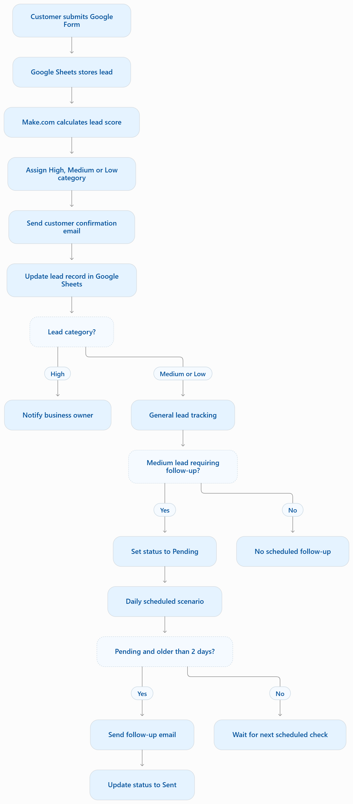

# Business Lead Qualification & Follow-Up Automation

## Project Overview

This project demonstrates an automated lead management system built with **Make.com**. It helps businesses capture new inquiries, evaluate potential customers, categorize leads by priority, and send timely follow-up emails.

The solution reduces manual work, improves response consistency, and helps businesses avoid overlooking potential customers.

## Business Problem

Businesses often receive customer inquiries through online forms. Manually reviewing each inquiry, prioritizing leads, sending confirmation emails, and remembering to follow up can be time-consuming.

This automation streamlines that process using connected business applications and predefined qualification rules.

## Tools & Technologies

- Make.com – Workflow automation
- Google Forms – Lead collection
- Google Sheets – Lead database and tracking
- Gmail – Automated customer emails and internal notifications

## Key Features

- **Automated lead capture:** New form submissions are recorded in Google Sheets.
- **Lead scoring:** Each lead receives a score based on urgency, budget, consultation interest, and email type.
- **Lead classification:** Leads are categorized as High, Medium, or Low priority.
- **Automated routing:** A Make.com router directs leads through the appropriate workflow.
- **Customer confirmation:** Customers receive an automatic confirmation email.
- **High-priority notifications:** High-priority leads trigger an email notification to the business owner.
- **Scheduled follow-up:** Medium-priority leads requiring follow-up are identified after two days.
- **Follow-up tracking:** Google Sheets records follow-up status to help prevent duplicate emails.

## Lead Scoring Rules

| Qualification factor | Condition | Points |
|---|---|---:|
| Urgency | Urgent | +3 |
| Budget | $1,000 or more | +3 |
| Consultation | Yes | +2 |
| Email type | Business | +1 |

### Lead Categories

- High: 7–9 points
- Medium: 4–6 points
- Low: 0–3 points

## Workflow Diagram




### 1. Lead Qualification

Google Forms captures the inquiry. Make.com processes the submission, calculates the lead score, assigns a category, and updates the Google Sheets record.

### 2. Lead Routing

A router separates high-priority leads from medium- and low-priority leads.

- High-priority leads trigger an email notification to the business owner.
- Medium- and low-priority leads continue through the general tracking route.
- Medium-priority leads requiring follow-up are marked as `Yes` with a status of `Pending`.

### 3. Automated Follow-Up

A separate scheduled Make.com scenario checks pending follow-ups daily.

It identifies medium-priority leads that:
- Require follow-up.
- Have a pending follow-up status.
- Were submitted more than two days ago.

The system sends a follow-up email and updates the status to `Sent`.

## Business Value

This solution helps businesses:

- Reduce repetitive administrative tasks.
- Prioritize valuable customer inquiries.
- Respond consistently to new leads.
- Improve follow-up processes.
- Maintain an organized lead database.
- Reduce the risk of sending duplicate follow-up emails.

## Project Structure

```text
Business-Lead-Qualification-Automation/
│
├── README.md
├── screenshots/
├── documentation/
└── diagrams/
```

## Project Status

The lead qualification and scheduled follow-up workflows have been configured and tested in Make.com.

Screenshots, workflow diagrams, and additional documentation will be added to this repository as the project portfolio is developed.

## Project Documentation

Explore the project documentation:

Explore the project documentation:

- [Business Rules](documentation/business-rules.md)
- [Workflow Overview](documentation/workflow-overview.md)
- [Workflow Diagram](documentation/workflow-diagram.png)

## Screenshots

Screenshots demonstrating the actual Make.com scenarios, lead tracking spreadsheet, and automated email examples will be added here.

## Future Improvements

- Introduce AI-assisted lead classification.
- Add lead performance analytics and reporting dashboards.
- Integrate CRM platforms.
- Expand automated follow-up workflows.


## Author

Solomon Pinto  
MS Data Analytics | Data Analytics | IT Support | AI Automation

GitHub: https://github.com/KOJOPINTO
